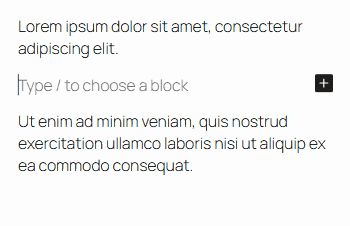
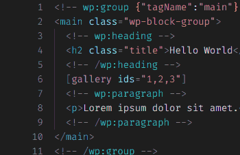
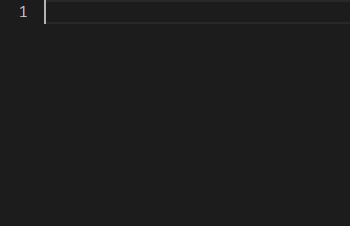
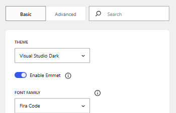
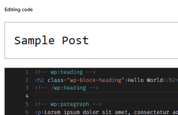

# Custom HTML Block Extension

[](https://github.com/t-hamano/custom-html-block-extension/actions/workflows/test.yml)
[](https://github.com/t-hamano/custom-html-block-extension/actions/workflows/deploy.yml)



Custom HTML Block Extension turns the Custom HTML block into an advanced code editor powered by Monaco Editor, the code editor behind VS Code.

## Features

### Syntax highlighting with 50 themes



Choose from 50 color themes to suit your taste. Block delimiters and shortcodes are highlighted, too.

### Faster coding with Emmet



Type short abbreviations, and Emmet expands them into full code snippets. You can also wrap selected code with an abbreviation.

### High customizability



Fine-tune the look and behavior of the editor to make it your own. You can also import your settings from VS Code and export them back.

### Works everywhere



The same editor is also available in the code editor of the post and site editors, the classic editor, and the theme and plugin file editors.

## Add custom fonts

In addition to the bundled fonts, you can add your own fonts to the font family options.

### Step 1: Place the font files

Place the font files where browsers can load them, such as a `fonts` folder in your theme. If you use a theme from the theme directory, use a child theme so that theme updates don't remove the files.

```text
wp-content
└── themes
    └── your-theme
        └── fonts
            ├── FantasqueSansMono-Bold.woff2
            ├── FantasqueSansMono-BoldItalic.woff2
            ├── FantasqueSansMono-Italic.woff2
            └── FantasqueSansMono-Regular.woff2
```

### Step 2: Create a CSS file

Create a CSS file to load the fonts, such as `chbe-fonts.css` in a `css` folder in the same theme.

```text
wp-content
└── themes
    └── your-theme
        ├── css
        │   └── chbe-fonts.css
        └── fonts
            ├── FantasqueSansMono-Bold.woff2
            ├── FantasqueSansMono-BoldItalic.woff2
            ├── FantasqueSansMono-Italic.woff2
            └── FantasqueSansMono-Regular.woff2
```

### Step 3: Define the fonts with `@font-face`

Define the fonts with `@font-face` in the CSS file. In the `src` property, set the path to each font file relative to the CSS file.

```css
@font-face {
	font-family: "Fantasque Sans Mono";
	src: url(../fonts/FantasqueSansMono-Regular.woff2) format("woff2");
	font-weight: 300;
}
@font-face {
	font-family: "Fantasque Sans Mono";
	src: url(../fonts/FantasqueSansMono-Bold.woff2) format("woff2");
	font-weight: 700;
}
@font-face {
	font-family: "Fantasque Sans Mono Italic";
	src: url(../fonts/FantasqueSansMono-Italic.woff2) format("woff2");
	font-weight: 300;
}
@font-face {
	font-family: "Fantasque Sans Mono Italic";
	src: url(../fonts/FantasqueSansMono-BoldItalic.woff2) format("woff2");
	font-weight: 700;
}
```

**Note:** This plugin doesn't support `font-style: italic`. To use an italic font, define it as a separate font family, such as `Fantasque Sans Mono Italic` above, without `font-style: italic`.

### Step 4: Register the fonts with the filter hook

Register the fonts with the `chbe_additional_font_families` filter hook, one array for each font family. For example, add the following to the `functions.php` file of your theme.

```php
function my_chbe_additional_font_families( $font_families ) {
	// Regular font
	$font_families[] = array(
		'label'      => 'Fantasque Sans Mono',
		'name'       => 'Fantasque Sans Mono',
		'stylesheet' => get_stylesheet_directory_uri() . '/css/chbe-fonts.css',
		'weight'     => array( 300, 700 ),
	);
	// Italic font
	$font_families[] = array(
		'label'      => 'Fantasque Sans Mono (Italic)',
		'name'       => 'Fantasque Sans Mono Italic',
		'stylesheet' => get_stylesheet_directory_uri() . '/css/chbe-fonts.css',
		'weight'     => array( 300, 700 ),
	);
	return $font_families;
}
add_filter( 'chbe_additional_font_families', 'my_chbe_additional_font_families' );
```

#### Properties

| Name       | Type   | Description                                                                                                                         |
| ---------- | ------ | ----------------------------------------------------------------------------------------------------------------------------------- |
| label      | string | The label shown in the font family dropdown on the settings page.                                                                   |
| name       | string | **The `font-family` name** defined in the CSS file in Step 3.                                                                       |
| stylesheet | string | **The URL of the CSS file** created in Step 2. If the file is in your theme, use `get_stylesheet_directory_uri()` to build the URL. |
| weight     | array  | The font weights defined in the CSS file, as numbers from 100 to 900.                                                               |

### Step 5: Check the fonts

Open **Settings > Custom HTML Block Extension** and check that the fonts appear in the "Font Family" dropdown on the "Editor config" tab. When you select one, the preview editor uses the font.

## How to build

```sh
npm install
npm run build
```

## Resources

### monaco-editor

* License: MIT License
* Source: <https://github.com/microsoft/monaco-editor>

### emmet-monaco-es

* License: MIT License
* Source: <https://github.com/troy351/emmet-monaco-es>

### monaco-themes

* License: MIT License
* Source: <https://github.com/brijeshb42/monaco-themes>

### Web Font (Fira Code)

* License: OFL-1.1 License
* Source: <https://github.com/tonsky/FiraCode>

### Web Font (Source Code Pro)

* License: OFL-1.1 License
* Source: <https://github.com/adobe-fonts/source-code-pro>

### Web Font (Ubuntu Mono)

* License: OFL-1.1 License
* Source: <https://ubuntu.com/legal/font-licence>

### Web Font (Anonymous Pro)

* License: OFL License
* Source: <https://www.marksimonson.com/fonts/view/anonymous-pro>

## Author

[Aki Hamano (GitHub)](https://github.com/t-hamano)
